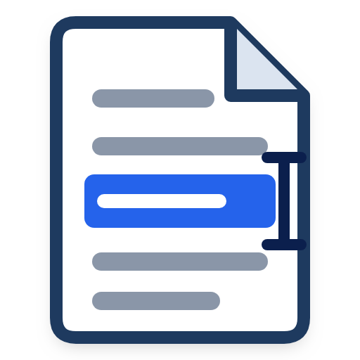

# Legible

Make scanned PDFs searchable on Windows. Queue PDFs or whole folders, and get back PDFs with an invisible text layer you can search, select and copy. Everything runs locally; nothing is uploaded anywhere.

A Legible build is one self-contained folder. There is nothing else to install: no Python, Ghostscript, Tesseract or Visual C++ redistributable.

## Requirements

- **To run:** Windows 10 version 1809 or later, x64.
- **To build:** the same, plus the [.NET 10 SDK](https://dotnet.microsoft.com/download) or newer, and an internet connection for the first build.

## Get started

```powershell
git clone https://github.com/matthewdeluxe/Legible.git C:\src\Legible
cd C:\src\Legible
powershell -ExecutionPolicy Bypass -File Build.ps1
.\Legible-App\Legible.exe
```

Clone to a short path like the one above. The WinUI XAML compiler and native DLL loading fail when paths pass Windows' 260-character limit.

The first build downloads the English OCR model, the page-orientation model and Tesseract's glyphless PDF font into `tessdata/` (about 15 MB). It also copies the Visual C++ runtime DLLs from the build machine into `vcruntime/` so they ship next to the app. The output in `Legible-App/` is about 280 MB, most of it the bundled .NET and Windows App SDK runtimes. Pass `-OutputDirectory <folder>` to build somewhere else.

To share a build, zip the whole `Legible-App` folder. The recipient unzips it and runs `Legible.exe`.

## Using the app

1. **Files & output:** add PDFs (files, a folder including subfolders, or pasted paths), then choose an output folder and filename suffix. Leave the folder blank to save beside each original.
2. **OCR settings:** choose how to treat pages that already have text, and whether to deskew and auto-rotate.
3. Select **Run OCR**. Progress appears on the **Log & results** tab, and **Open output folder** is enabled when a file succeeds.

You can also pass PDFs on the command line, for example `Legible.exe "C:\Scans\letter.pdf"`, or from a shortcut placed in the Send To menu. They are added to the queue.

### Text handling

| Mode | What it does |
| --- | --- |
| **Skip** (default) | OCRs only pages without text. Pages that already have text are left alone. |
| **Force OCR** | OCRs every page. Each page is replaced by an image of itself plus the OCR text, so existing text and vector graphics become part of the image. |
| **Redo OCR** | Replaces text that Legible added in an earlier run. Pages with other text are skipped. |
| **Strict** | Stops with an error if any page already has text. |

### Other options

- **Auto-rotate** detects sideways and upside-down pages and sets the page's rotation so it displays upright. The page content itself is not resampled.
- **Deskew** corrects slightly tilted scans. In Force OCR mode the page is visibly straightened. In the other modes the page is left as scanned and the hidden text is tilted to match, so selecting text still lines up.

## How it works

For each page that needs OCR, Legible renders the page, detects orientation and skew, recognizes the text with Tesseract, and lays the invisible text over the original page. Outside Force OCR mode the original page content is not changed, so image quality is preserved. Pages are processed in parallel.

| Folder | Contents |
| --- | --- |
| `src/Legible.App/` | The WinUI 3 desktop app. |
| `src/Legible.Core/` | The OCR engine, a C# library. |
| `src/Legible.Cli/` | A command-line front end to the same engine. |
| `Build.ps1` | Downloads OCR data and builds the app into `Legible-App/`. |

Built on [Tesseract](https://github.com/tesseract-ocr/tesseract) through the [Tesseract .NET wrapper](https://github.com/charlesw/tesseract), [PDFium](https://pdfium.googlesource.com/pdfium/) through [PDFtoImage](https://github.com/sungaila/PDFtoImage) and [SkiaSharp](https://github.com/mono/SkiaSharp), [PDFsharp](https://github.com/empira/PDFsharp) and [PdfPig](https://github.com/UglyToad/PdfPig).

## Command line

Run `Build.ps1` once first so `tessdata/` exists. Then, from the repository folder:

```powershell
dotnet run --project src/Legible.Cli -- input.pdf output.pdf
dotnet run --project src/Legible.Cli -- --mode force --no-deskew input.pdf output.pdf
```

| Option | Meaning |
| --- | --- |
| `--mode skip\|force\|redo\|strict` | How to treat pages that already have text (default `skip`). |
| `--no-deskew` | Don't correct skew. |
| `--no-rotate` | Don't auto-rotate pages. |
| `-l`, `--lang <codes>` | Tesseract languages, such as `eng+deu`. Each one needs its `.traineddata` file in `tessdata/`; only English is downloaded. |
| `-j`, `--jobs <n>` | Pages processed in parallel (default: half the CPU cores, up to 4). |
| `--dpi <n>` | Render resolution for OCR (default 300). |
| `--tessdata <folder>` | Use OCR data from another folder. |
| `-q`, `--quiet` | Print errors only. |

Exit codes: `0` success, `1` failed, `2` invalid arguments, `130` cancelled with Ctrl+C.

## Safety notes

- Each file is written to a temporary file first and moved into place only after it succeeds. Failed or cancelled files leave originals untouched.
- Existing output files and duplicate output names are rejected rather than overwritten.
- Replace mode asks for confirmation on every batch and keeps a `.pdf.bak` copy of each original by default. It is always off when the app starts.
- Force OCR changes a document more than the other modes. Try new settings on copies first.
- Settings are stored in `%LOCALAPPDATA%\Legible\settings.json`. Settings from the earlier OCRmyPDF front end are picked up on first run.

## Limitations

- OCR is English only in the app.
- Password-protected PDFs can't be opened. Remove the password first.
- No PDF/A output, size optimization (pngquant, jbig2), unpaper cleaning or background removal, which the earlier OCRmyPDF-based version offered. Force OCR output can be larger than the input.

## Troubleshooting

| Symptom | Likely cause and fix |
| --- | --- |
| Windows SmartScreen warns about the app | Builds aren't code-signed. Select **More info**, then **Run anyway**, if you built or trust the copy. |
| App won't start | Look for `startup-error.txt` next to `Legible.exe`, and keep the whole `Legible-App` folder together. |
| "OCR data folder not found" or "Missing OCR data" | The `tessdata` folder next to the exe is missing or incomplete. Rebuild, or copy that folder from another build. |
| "Failed to find library leptonica-1.82.0.dll" | The `x64` folder is missing, or the app is in a folder with a very long path. Move it to a shorter path. |
| "Cannot open PDF (encrypted or damaged?)" | The file is password-protected or corrupt. |
| Build fails with "Xaml compiler error" or "Input JSON file doesn't exist" | The repository path is too long. Clone to a short path. |
| Build fails with "Could not resolve SDK Microsoft.NET.Sdk" | A stale `MSBuildSDKsPath` environment variable points at a removed SDK. `Build.ps1` ignores it; for other builds, delete the variable. |

## Licensing

Legible is MIT licensed. See [LICENSE](LICENSE).

Third-party components: Tesseract, its OCR data and PdfPig are Apache-2.0. PDFtoImage, SkiaSharp and PDFsharp are MIT. PDFium is BSD-3-Clause and Apache-2.0. The Visual C++ runtime DLLs are redistributed under Microsoft's Visual C++ redistributable terms.

PDFsharp is pinned to 6.2.4, its last MIT release. PDFsharp 6.5 and later are AGPL-3.0, so don't upgrade it without reviewing the license.
